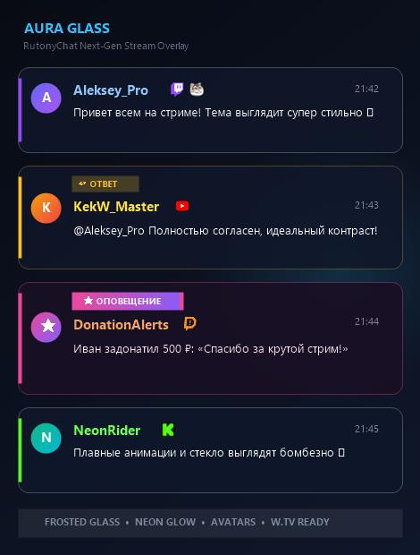

# ✨ Aura Glass — Modern Glassmorphism Theme for RutonyChat

<p align="center">
  
</p>

<p align="center">
  <b>Aura Glass</b> — премиальная тема для чата <b>RutonyChat</b> и <b>OBS Studio</b> в стиле <i>Glassmorphism</i>.<br>
  Эффект матового стекла, плавные неоновые акценты, динамические анимации и полная кастомизация.
</p>

---

## 🌟 Особенности / Features

- 🧊 **Frosted Glass (Glassmorphism)**: глубокое размытие фона (`backdrop-filter: blur`), стильные полупрозрачные карточки и тонкие световые границы.
- 🎨 **4 стиля карточек**:
  - `Glass` — фирменное матовое стекло.
  - `Solid` — контрастный темный минимализм.
  - `Neon` — киберпанк с яркой акцентной обводкой.
  - `Minimal` — чистый чат без лишних рамок.
- 🌈 **24 настраиваемых параметра** в меню RutonyChat (цвета, шрифты, прозрачность, скругления, размеры).
- 🏷️ **Поддержка аватаров и бейджей**: круглые аватары, значки сабов, модераторов, VIP.
- 📡 **Мультиплатформенность**: Twitch, YouTube, Kick, VK Play, Trovo, GoodGame, Discord, Telegram, TikTok, DonationAlerts, NUUM.
- ⚡ **W.TV Bridge**: поддержка расширенных событий W.TV.
- 🎭 **Smooth Spring Animations**: плавное появление и скрытие сообщений.
- 🧪 **Встроенный демо-режим**: откройте `template.html` прямо в браузере для предпросмотра с тестовыми сообщениями!

---

## 🚀 Установка / Installation

### Способ 1: Установка в RutonyChat
1. Скачайте архив [`release.zip`](release.zip) из репозитория или со вкладки **Releases**.
2. Распакуйте содержимое архива в папку тем RutonyChat:
   ```text
   <Путь_к_Steam>\steamapps\common\RutonyChat\Themes\AuraGlass\
   ```
3. Запустите RutonyChat, перейдите в **Настройки** → **Темы** и выберите **Aura Glass** (или папку темы).
4. Настройте внешний вид под свой стрим во вкладке параметров.

### Способ 2: Использование в OBS Studio
1. В OBS добавьте источник **Браузер** (Browser Source).
2. Выберите **Локальный файл** (Local file) и укажите путь к `template.html` (или `player.html` в связке с RutonyChat).
3. Рекомендуемый размер: ширина `450-550px`, высота `700-900px`.
4. Отметьте галочку «Обновлять браузер, когда сцена становится активной» при необходимости.

---

## ⚙️ Настройки темы (Параметры)

| Параметр | По умолчанию | Описание |
| :--- | :---: | :--- |
| **CardStyle** | `glass` | Стиль карточки (`glass`, `solid`, `neon`, `minimal`) |
| **CardBgColor** | `#0d111d` | Базовый цвет фона карточки |
| **CardOpacity** | `80%` | Прозрачность фона |
| **BorderRadius** | `14px` | Радиус скругления карточек |
| **GlowIntensity** | `8px` | Сила неонового свечения |
| **ShowAvatars** | `true` | Показывать аватары пользователей |
| **ShowBadges** | `true` | Показывать значки платформ и ролей |
| **FontSize** | `16px` | Размер шрифта текста сообщения |
| **NicknameColor** | `#38bdf8` | Цвет никнейма по умолчанию |
| **MaxMessages** | `10` | Максимальное количество отображаемых сообщений |
| **HideTimeout** | `30s` | Время до исчезновения сообщения (0 — не скрывать) |

---

## 📁 Структура проекта

```text
├── images/             # Иконки платформ и бейджи
├── chat.css            # Стили темы, анимации и glassmorphism
├── params.json         # Манифест настроек для RutonyChat
├── preview.jpg         # Превью для Workshop и предпросмотра
├── template.html       # Шаблон чата, WebSocket-клиент и движок темы
└── release.zip         # Готовый архив для быстрой установки
```

---

## 📄 Лицензия / License

Распространяется под лицензией [MIT](LICENSE). Вы можете свободно использовать, модифицировать и кастомизировать тему для своих стримов.
